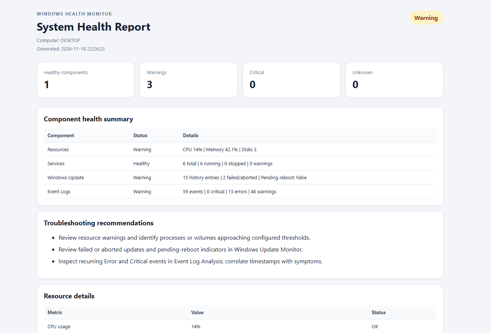
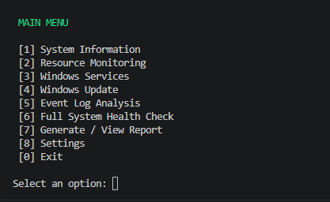

# Windows Health Monitor

A PowerShell 7+ interactive CLI tool for read-only diagnostics and health assessment on Windows 10/11.

Windows Health Monitor collects system information, monitors resource usage, checks selected Windows services, reviews Windows Update history, analyzes System/Application event logs, and generates HTML, JSON, and CSV reports.

## Features

- **System information** — computer, manufacturer/model, Windows version/build, processor, memory, boot time, and uptime.
- **Resource monitoring** — CPU, physical memory, and fixed-disk usage with configurable warning/critical thresholds.
- **Windows services** — inspect all services or a configured subset; identify stopped automatic-start services.
- **Windows Update** — review recent update history, identify failed/aborted entries, and check common pending-reboot indicators.
- **Event log analysis** — review Critical, Error, and Warning events in the System and Application logs; identify recurring issues.
- **Full system health check** — combine the diagnostic modules into an overall Healthy, Warning, Critical, or Unknown assessment.
- **Report generation** — export a timestamped HTML report, JSON data file, and CSV component summary.
- **Centralized configuration and logging** — configure thresholds and monitored services in JSON; write daily application logs.
- **Automated tests** — Pester test suite covering configuration, modules, health assessment, and report generation.

## Menu

```text
[1] System Information
[2] Resource Monitoring
[3] Windows Services
[4] Windows Update
[5] Event Log Analysis
[6] Full System Health Check
[7] Generate / View Report
[8] Settings
[0] Exit
```

## Screenshots

### System Health Report

The HTML report provides an overview of the computer's health, component status, and troubleshooting recommendations.



### Interactive CLI Menu

The interactive PowerShell menu provides access to each diagnostic module.



## Requirements

- Windows 10 or Windows 11
- PowerShell 7.0 or later
- Pester 5 or later to run the automated tests

Check your PowerShell version:

```powershell
$PSVersionTable.PSVersion
```

Install Pester for the current user if it is not already installed:

```powershell
Install-Module Pester -Scope CurrentUser -Force
```

> Windows Health Monitor uses Windows-specific facilities such as CIM, `Get-Volume`, `Get-Service`, `Get-WinEvent`, the Windows Update COM API, and Windows registry locations. Run it on Windows; some checks may require elevated permissions or may be unavailable on restricted systems.

## Getting started

Clone the repository and open PowerShell 7 in the project directory:

```powershell
git clone <your-repository-url>
Set-Location .\windows-health-monitor
```

Run the application:

```powershell
pwsh -ExecutionPolicy Bypass -File .\src\main.ps1
```

The application is read-only. It collects diagnostic information and creates report files; it does not automatically repair Windows, change system settings, stop/start services, or install updates.

## Configuration

Edit `config/settings.json` to adjust thresholds and monitoring options.

| Setting | Default | Description |
|---|---:|---|
| `thresholds.cpuWarning` | `80` | CPU warning threshold (%) |
| `thresholds.cpuCritical` | `95` | CPU critical threshold (%) |
| `thresholds.memoryWarning` | `85` | Memory warning threshold (%) |
| `thresholds.memoryCritical` | `95` | Memory critical threshold (%) |
| `thresholds.diskFreeWarning` | `15` | Warning when free disk space is below this percentage |
| `thresholds.diskFreeCritical` | `5` | Critical when free disk space is below this percentage |
| `eventLog.lookbackHours` | `24` | Event log analysis lookback window |
| `eventLog.maxEventsPerLog` | `500` | Maximum events collected per log |
| `eventLog.levels` | `Critical`, `Error`, `Warning` | Event levels included in analysis |
| `services.monitorList` | 6 service names | Services included in the default service check and full health check |
| `windowsUpdate.historyLimit` | `20` | Number of recent Windows Update history entries to inspect |
| `reporting.outputDirectory` | `reports` | Report output directory |
| `reporting.formats` | `html`, `json`, `csv` | Report formats to generate |

The default monitored services are `Dhcp`, `Dnscache`, `EventLog`, `Spooler`, `Winmgmt`, and `wuauserv`.

## Reports

Select **[7] Generate / View Report** from the main menu.

- **Generate** runs a fresh full system health check and creates the configured report formats.
- **View** opens the most recently generated HTML report in the default browser.

Reports are written to `reports/` by default and use timestamped filenames:

```text
reports/
├── health-report-YYYYMMDD-HHmmss.html
├── health-report-YYYYMMDD-HHmmss.json
└── health-report-YYYYMMDD-HHmmss.csv
```

The HTML report includes the overall status, component summary, troubleshooting recommendations, resource details, Windows services, Windows Update history, and event log analysis.

## Run automated tests

From the project root, run:

```powershell
Invoke-Pester .\tests -Output Detailed
```

Latest verified test result:

```text
Pester 6.2.0
Tests Passed: 46
Failed: 0
Skipped: 0
```

The test result above was verified during development on the project author's Windows environment. Test counts may change as the project evolves.

## Project structure

```text
windows-health-monitor/
├── assets/
│   ├── health-report.png
│   └── main-menu.png
├── config/
│   └── settings.json
├── logs/
├── reports/
├── src/
│   ├── core/
│   │   ├── Config.ps1
│   │   ├── Console.ps1
│   │   └── Logger.ps1
│   ├── modules/
│   │   ├── EventLogAnalyzer.psm1
│   │   ├── HealthCheck.psm1
│   │   ├── ReportGenerator.psm1
│   │   ├── SystemMonitor.psm1
│   │   ├── WindowsServicesMonitor.psm1
│   │   └── WindowsUpdateMonitor.psm1
│   └── main.ps1
├── tests/
│   ├── Config.Tests.ps1
│   ├── Console.Tests.ps1
│   ├── EventLogAnalyzer.Tests.ps1
│   ├── HealthCheck.Tests.ps1
│   ├── ReportGenerator.Tests.ps1
│   ├── SystemMonitor.Tests.ps1
│   ├── WindowsServicesMonitor.Tests.ps1
│   └── WindowsUpdateMonitor.Tests.ps1
├── .gitignore
└── README.md
```

## Technology

- PowerShell 7+
- Windows Management Instrumentation / CIM
- Windows services and Event Log
- Windows Update COM API
- JSON configuration
- Pester automated testing
- HTML, JSON, and CSV reporting

## Safety and limitations

- The tool is designed for read-only diagnostics; it does not perform automatic remediation.
- Event log analysis currently covers the **System** and **Application** logs and the configured lookback period.
- Windows Update history and pending-reboot checks depend on Windows Update and registry interfaces being accessible.
- A Warning status indicates that one or more configured checks crossed a threshold or reported an issue. It is an investigation prompt, not by itself proof of hardware failure.
- Run with appropriate permissions for the most complete diagnostic results.

## License

No license has been specified yet. Add a license file before allowing others to redistribute or reuse this project.
